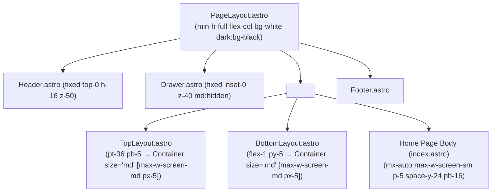
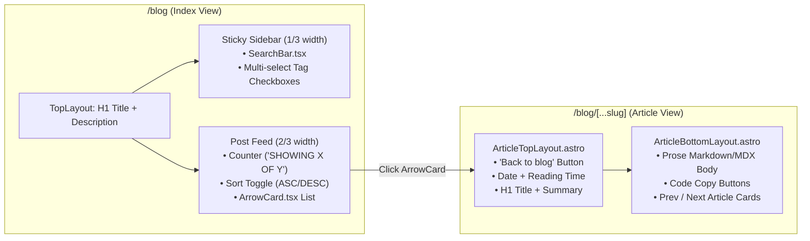

# Astro Sphere — Front-End Design System & Component Specification

> **Purpose**: This document defines the complete Front-End Design System for the Personal Profile (**Astro Sphere**) application. It documents the visual foundations (tokens, typography, colors, spacing, motion) and provides exact structural and styling specifications for all 9 core UI domains: **Navigation, Blog, Card, My Work, Projects, About, Recent Work, Connect, and Footer**.

---

## 1. Design Foundations & Global Tokens

### 1.1 Aesthetic Philosophy
Astro Sphere follows a **high-contrast, monochrome, cosmic-minimalist** design language inspired by Paco Coursey, Lee Robinson, and Hayden Bleasel:
- **Zero decorative color noise**: Almost the entire UI is built from pure `black` and `white` with precise alpha-opacity steps (`/5`, `/10`, `/15`, `/20`, `/25`, `/50`, `/75`), except for a single pulsing green status indicator in the footer.
- **Tactile micro-interactions**: Links, cards, and buttons rely on subtle background fills, border brightening, and SVG stroke/line animations (`300ms ease-in-out`).
- **Atmospheric depth**: The home page combines a CSS particle/starfield canvas, twinkling SVG stars, diagonal meteors, and a glowing planetary horizon arc.

---

### 1.2 Color & Theme Tokens (`darkMode: ["class"]`)

Theme state is controlled by toggling the `.dark` class on `<html>` via `public/js/theme.js` (persisted in `localStorage.theme`). Every UI element **must** pair a light-mode class with its `dark:` counterpart:

| Token Role | Light Mode Class | Dark Mode Class | Computed Usage |
| :--- | :--- | :--- | :--- |
| **Page Canvas Background** | `bg-white` | `dark:bg-black` | `<html>`, `<body>`, `<main>`, `<footer>` |
| **Mobile Drawer Surface** | `bg-neutral-100` | `dark:bg-neutral-900` | Full-screen mobile menu background |
| **Elevated / Input Surface** | `bg-black/5` | `dark:bg-white/10` | Search input, tag filter pills, tag badges (`dark:bg-white/20`) |
| **Interactive Hover Surface** | `hover:bg-black/5` | `hover:dark:bg-white/10` | Cards, back buttons, pagination buttons (inputs use `/10` & `/15`) |
| **Inverted Active Pill / Primary CTA** | `bg-black text-white` | `dark:bg-white dark:text-black` | Active navbar link, primary Hero CTA button |
| **Primary Heading Text** | `text-black` | `dark:text-white` | Titles, headings, active labels, hover text |
| **Body / Default Text** | `text-black/75` | `dark:text-white/75` | Default inherited body copy and muted descriptions |
| **Subtle / Control Text** | `text-neutral-400` | `dark:text-neutral-500` | Sort toggles, search placeholders, stack card labels |
| **Subtle Divider Border** | `border-black/10` | `dark:border-white/25` | Header bottom border, footer section dividers, work timeline dividers, icon buttons |
| **Card & Button Border** | `border-black/15` | `dark:border-white/20` | `ArrowCard`, Prev/Next cards, "Back to..." button |
| **Strong Action Border** | `border-black/25` | `dark:border-white/25` | Secondary Hero CTA, Demo/Repo links, `Counter` button |
| **Status Indicator (Online)** | `bg-green-500` (`bg-green-300` ping) | `bg-green-500` (`bg-green-300` ping) | Footer "All systems normal" live dot |

---

### 1.3 Typography System

- **Font Family**: `"Atkinson"` (Atkinson Hyperlegible), self-hosted in `/public/fonts/atkinson-regular.woff` (`400`) and `/public/fonts/atkinson-bold.woff` (`700`), preloaded in `BaseHead.astro`.
- **Prose Content**: Styled via `@tailwindcss/typography` (`prose dark:prose-invert max-w-full pb-12`).

| Typographic Element | Tailwind Classes |
| :--- | :--- |
| **Hero Display Name** | `text-2xl md:text-3xl lg:text-4xl font-bold uppercase text-black dark:text-white` |
| **Hero Greeting** | `text-lg md:text-xl lg:text-2xl font-semibold opacity-75` |
| **Article / Collection H1** | `text-3xl font-semibold text-black dark:text-white mt-2` |
| **Page Heading (`.page-heading`)** | `font-semibold text-black dark:text-white` (defined in `global.css`) |
| **Section / Card Title** | `font-semibold text-black dark:text-white` |
| **Metadata / Counter Label** | `text-sm uppercase` (dates, reading time, `SHOWING X OF Y`) |
| **Tag Badge Text** | `text-xs uppercase py-0.5 px-2` |

---

### 1.4 Layout Grid, Containers & Spacing



- **`Container.astro` Width Tokens**:
  - `size="sm"` $\rightarrow$ `max-w-screen-sm` (`640px`) — *Note: Home page uses `max-w-screen-sm` directly for a tighter reading column.*
  - `size="md"` $\rightarrow$ `max-w-screen-md` (`768px`) — *Standard width used by `Header`, `Footer`, `TopLayout`, and `BottomLayout`.*
  - `size="lg"` $\rightarrow$ `max-w-screen-lg` (`1024px`)
  - `size="xl"` $\rightarrow$ `max-w-screen-xl` (`1280px`)
  - `size="2xl"` $\rightarrow$ `max-w-screen-2xl` (`1536px`)

---

### 1.5 Motion & Animation System

1. **Micro-Transition Utility (`.blend`)**:
   - Defined in `src/styles/global.css`: `@apply transition-all duration-300 ease-in-out;`
   - Applied to links, icons, cards, and buttons for uniform hover feedback.
2. **Staggered Page Entrance (`.animate` $\rightarrow$ `.animate.show`)**:
   - Initial CSS state: `opacity: 0; transform: translateY(50px); transition: opacity 1s ease, transform 1s ease;`
   - Triggered by `public/js/animate.js` on `DOMContentLoaded` and `astro:after-swap` with a `150ms * index` stagger.
3. **Animated Hover Arrow SVG**:
   - Used in `ArrowCard.tsx`, `ArticleTopLayout.astro`, `ArticleBottomLayout.astro`, and `Footer.astro`.
   - Consists of a horizontal `<line>` that scales from `scale-x-0` to `group-hover:scale-x-100` while the `<polyline>` chevron translates by `1` unit on hover.

---

## 2. Component & Section Specifications

---

### 2.1 Navigation (`Header.astro` & `Drawer.astro`)

#### Purpose & Behavior
Provides persistent top-level site navigation, brand identity, global search access, RSS feed link, and light/dark theme switching across desktop and mobile viewports.

#### Desktop Header (`src/components/Header.astro`)
- **Positioning**: `fixed top-0 w-full h-16 z-50` with `transition-all duration-300 ease-in-out`.
- **Scroll Behavior (`public/js/scroll.js`)**:
  - **At Top (`window.scrollY === 0`)**: `header:not(.scrolled)` $\rightarrow$ `bg-transparent border-transparent`.
  - **Scrolled (`window.scrollY > 0`)**: `header.scrolled` $\rightarrow$ `bg-white/75 dark:bg-black/50 border-black/10 dark:border-white/25 backdrop-blur-sm saturate-200` (frosted glass effect).
- **3-Zone Internal Layout** (inside `<Container size="md">` $\rightarrow$ `<div class="relative h-full w-full">`):
  1. **Left Zone (Brand)**: `absolute left-0 top-1/2 -translate-y-1/2`
     - `<a href="/">` with `<svg class="size-6 fill-current"><use href="/brand.svg#brand"></use></svg>` and `{SITE.TITLE}` in `font-semibold`.
  2. **Center Zone (Primary Nav Pills)**: `absolute left-1/2 top-1/2 -translate-x-1/2 -translate-y-1/2`
     - `<nav class="hidden md:flex items-center justify-center text-sm gap-1">`
     - **Nav Item Pill**: `h-8 rounded-full px-3 flex items-center justify-center transition-colors duration-300 ease-in-out`
     - **Active State** (matches `pathname` or `subpath[0]`): `bg-black dark:bg-white text-white dark:text-black`
     - **Inactive State**: `text-current hover:bg-black/5 dark:hover:bg-white/20 hover:text-black dark:hover:text-white`
  3. **Right Zone (Utility Icon Buttons)**: `buttons absolute right-0 top-1/2 -translate-y-1/2 flex gap-1`
     - **Circular Icon Button Base**: `size-9 rounded-full p-2 items-center justify-center bg-transparent hover:bg-black/5 dark:hover:bg-white/20 stroke-current hover:stroke-black hover:dark:stroke-white border border-black/10 dark:border-white/25 transition-colors duration-300 ease-in-out`
     - **Buttons**:
       - **Search (`/search`)**: `hidden md:flex`, uses `/ui.svg#search`. Shows inverted active state when on `/search`.
       - **RSS (`/rss.xml`)**: `hidden md:flex`, uses `/ui.svg#rss`.
       - **Theme Toggle (`#header-theme-button`)**: `hidden md:flex`, swaps `/ui.svg#sun` (`block dark:hidden`) and `/ui.svg#moon` (`hidden dark:block`).
       - **Mobile Hamburger Toggle (`#header-drawer-button`)**: `flex md:hidden`, swaps `#drawer-open` (`/ui.svg#menu`) and `#drawer-close` (`/ui.svg#x`) when `.open` is toggled.

#### Mobile Navigation Drawer (`src/components/Drawer.astro`)
- **Container**: `fixed inset-0 h-0 z-40 overflow-hidden flex flex-col items-center justify-center md:hidden bg-neutral-100 dark:bg-neutral-900 transition-[height] duration-300 ease-in-out`
- **Open State**: `#drawer.open { @apply h-full; }`
- **Contents**: Vertical stack of pill links (`flex flex-col items-center space-y-2`) + horizontal row of the 3 utility icon buttons (`Search`, `RSS`, `#drawer-theme-button`) below (`flex gap-1 mt-5`).

---

### 2.2 Blog (`src/pages/blog/*`, `SearchCollection.tsx`, `Article*Layout.astro`)

The Blog domain consists of two distinct view templates: the **Filterable Collection Index (`/blog`)** and the **Article Reading View (`/blog/[...slug]`)**.



#### A. Blog Index View (`src/pages/blog/index.astro` + `src/components/SearchCollection.tsx`)
- **Header (`TopLayout`)**:
  - `h1`: `text-3xl font-semibold text-black dark:text-white mt-2`
  - Subtitle: `mt-1` default muted text.
- **Interactive Body (`BottomLayout` $\rightarrow$ `<SearchCollection client:load />`)**:
  - Pre-allocates min-height (`28 + posts.length * 158 + (posts.length - 1) * 12` px) on `#search-collection-wrapper` until SolidJS mounts to prevent layout shift (CLS).
  - **Grid Layout**: `grid grid-cols-1 sm:grid-cols-3 gap-6`
  - **Left Column — Control Panel (`col-span-3 sm:col-span-1` $\rightarrow$ `sticky top-24 mt-7`)**:
    - **`SearchBar.tsx`**: Relative input wrapper with left search icon (`/ui.svg#search`), text input (`w-full px-10 py-1.5 rounded outline-none bg-black/5 dark:bg-white/10 hover:bg-black/10 hover:dark:bg-white/15 focus:bg-black/10 focus:dark:bg-white/15 border border-black/10 dark:border-white/10 focus:border-black/40 focus:dark:border-white/40`), and conditional right clear button (`/ui.svg#x`).
    - **Tags Header**: `text-sm font-semibold uppercase my-4 text-black dark:text-white` with a clear-all-filters `x` button when `filter().size > 0`.
    - **Tag Filter List**: `<ul class="flex flex-wrap sm:flex-col gap-1.5">`. Each tag button (`w-full px-2 py-1 rounded flex gap-2 items-center bg-black/5 dark:bg-white/10 hover:bg-black/10 hover:dark:bg-white/15`) toggles `/ui.svg#square` (unchecked) and `/ui.svg#square-check` (checked, `fill-black dark:fill-white`).
  - **Right Column — Results Feed (`col-span-3 sm:col-span-2`)**:
    - **Info Bar**: `flex justify-between flex-row mb-2` containing `SHOWING X OF Y POSTS` (`text-sm uppercase`) and the sort direction button (`ASCENDING` / `DESCENDING` with `/ui.svg#sort-ascending` and `#sort-descending`).
    - **Card Stack**: `<ul class="flex flex-col gap-3">` rendering `<ArrowCard entry={entry} />`.

#### B. Blog Article Reading View (`ArticleTopLayout.astro` & `ArticleBottomLayout.astro`)
- **Back Button**: `<a href="/blog" class="group w-fit p-1.5 gap-1.5 text-sm flex items-center border rounded hover:bg-black/5 hover:dark:bg-white/10 border-black/15 dark:border-white/20 transition-colors duration-300 ease-in-out">` with left-pointing animated arrow SVG.
- **Metadata Row**: `flex flex-wrap text-sm uppercase mt-12 gap-3 opacity-75` displaying `#calendar` + `formatDate(date)` and `#book-open` + `readingTime(body ?? "")`.
- **Article Body**: `<article>` styled with `@apply prose dark:prose-invert max-w-full pb-12;`. Images inside `<article>` are centered (`display: block; margin: 0 auto; padding: 20px 0;`).
- **Code Block Copy Button (`public/js/copy.js`)**: Automatically injects `.copy-cnt` and `.copy-btn` into every `pre:has(code)`, switching `/copy.svg#empty` to `/copy.svg#filled` for `100ms` on click.
- **Prev / Next Circular Navigation**: `grid grid-cols-1 sm:grid-cols-2 gap-4` at the bottom of the article, wrapping around the collection via modulo arithmetic.

---

### 2.3 Card System (`ArrowCard.tsx` & `StackCard.astro`)

Cards are the primary repeatable surface pattern in Astro Sphere. There are two card components:

#### A. Primary Content Card (`src/components/ArrowCard.tsx`)
Used for blog posts, projects, and global search results.

```text
+-----------------------------------------------------------------------+
| [post/project pill]  MAR 17, 2024                                     |
|                                                                       |
| Astro Sphere: File Structure                                      --> |
| You'll find these directories and files in the project...             |
|                                                                       |
| [TUTORIAL]  [ASTRO]  [ASTRO SPHERE]                                   |
+-----------------------------------------------------------------------+
```

- **Outer Container (`<a>`)**:
  ```html
  class="group p-4 gap-3 flex items-center border rounded-lg hover:bg-black/5 hover:dark:bg-white/10 border-black/15 dark:border-white/20 transition-colors duration-300 ease-in-out"
  ```
- **Content Column (`div.w-full`)**: `w-full group-hover:text-black group-hover:dark:text-white blend`
  - **Top Meta Row (`flex flex-wrap items-center gap-2`)**:
    - **Optional Collection Pill** (when `pill={true}`, e.g., on `/search`): `text-sm capitalize px-2 py-0.5 rounded-full border border-black/15 dark:border-white/25` (`"post"` or `"project"`).
    - **Date**: `text-sm uppercase` (`formatDate(entry.data.date)`).
  - **Title**: `font-semibold mt-3 text-black dark:text-white line-clamp-2`
  - **Summary**: `text-sm line-clamp-2`
  - **Tags List (`<ul class="flex flex-wrap mt-2 gap-1">`)**:
    - Each `<li>`: `text-xs uppercase py-0.5 px-2 rounded bg-black/5 dark:bg-white/20 text-black/75 dark:text-white/75` (text truncated to 20 chars via `truncateText(tag, 20)`).
- **Right Animated Arrow (`<svg>`)**:
  - `stroke-current group-hover:stroke-black group-hover:dark:stroke-white`
  - `<line>`: `scale-x-0 group-hover:scale-x-100 translate-x-4 group-hover:translate-x-1 transition-all duration-300 ease-in-out`
  - `<polyline>`: `translate-x-0 group-hover:translate-x-1 transition-all duration-300 ease-in-out`

#### B. Tech Stack Badge Card (`src/components/StackCard.astro`)
Used on the Home page to showcase technologies (`Astro`, `Javascript`, `Typescript`, `Tailwind`).
- **Outer Container (`<a>`)**:
  ```html
  class="w-fit px-3 py-2 group rounded border flex gap-2 items-center border-neutral-200 dark:border-neutral-700 hover:bg-neutral-100 hover:dark:bg-neutral-800 blend"
  ```
- **Icon**: `<svg height={20} width={20}><use href="/stack.svg#${icon}"></use></svg>`
- **Label**: `text-sm capitalize text-neutral-500 dark:text-neutral-400 group-hover:text-black group-hover:dark:text-white blend`

---

### 2.4 My Work (`src/pages/work/index.astro`)

#### Purpose & Layout
Displays a vertical, reverse-chronological career history timeline at `/work`. Unlike Blog and Projects, Work entries are rendered inline on a single page without separate detail URLs or search filters.

#### Structural Anatomy
- **Top Section (`TopLayout`)**: `<div class="animate page-heading">{WORK.TITLE}</div>`
- **Timeline Feed (`BottomLayout` $\rightarrow$ `<ul>`)**:
  - **Timeline Item (`<li>`)**:
    ```html
    class="animate border-b border-black/10 dark:border-white/25 mt-4 py-8 first-of-type:mt-0 first-of-type:pt-0 last-of-type:border-none"
    ```
  - **Date Range**: `text-sm uppercase mb-4` — formatted as `MMM YYYY - MMM YYYY` or `MMM YYYY - Now` via `formatWorkDate()`.
  - **Company Name**: `text-black dark:text-white font-semibold`
  - **Job Title / Role**: `text-sm font-semibold`
  - **Accomplishments Body**: `<article class="prose dark:prose-invert">` rendering the Markdown body (paragraphs and bulleted lists).

---

### 2.5 Projects (`src/pages/projects/*`)

#### Purpose & Layout
Showcases software/design portfolio projects with live demo and source code links.

#### Structural Anatomy
1. **Projects Index (`/projects` — `src/pages/projects/index.astro`)**:
   - Identical layout and interactive architecture to the Blog Index: uses `TopLayout` for the title/description and `BottomLayout` with `<SearchCollection client:load entry_name="projects" tags={tags} data={projects} />`.
2. **Project Detail (`/projects/[...slug]` — `src/pages/projects/[...slug].astro`)**:
   - Shares `ArticleTopLayout.astro` and `ArticleBottomLayout.astro` with Blog posts, plus an exclusive **External Project Links Bar** in `ArticleTopLayout.astro` when `demoUrl` or `repoUrl` is defined in frontmatter:
   - **Action Links Container**: `<div class="mt-4 flex flex-wrap gap-2">`
   - **Demo / Repo Button Style**:
     ```html
     class="group flex gap-2 items-center px-3 py-1.5 truncate rounded text-xs md:text-sm lg:text-base border border-black/25 dark:border-white/25 hover:bg-black/5 hover:dark:bg-white/15 blend"
     ```
   - **Icons**: `/ui.svg#globe` ("See Demo") and `/ui.svg#link` ("See Repository") with `size-4 fill-current group-hover:fill-black group-hover:dark:fill-white blend`.

---

### 2.6 About (`src/pages/index.astro` — Hero, Bio & Tech Stack)

On the Home page (`/`), the personal introduction is split across three visual blocks:

#### Block 1: Cosmic Hero Banner (`section.relative.h-screen.w-full`)
- **Background Layers**:
  - **Light Mode Particles**: `#particles1`, `#particles2`, `#particles3` (`block dark:hidden`), generated via CSS `box-shadow` in `public/js/bg.js`.
  - **Dark Mode Starfield**: `#stars1`, `#stars2`, `#stars3` (`bg-black hidden dark:block`).
  - **Dark Mode Dynamic Galaxy (`#galaxy`)**: `<TwinklingStars />` (clones `#twinkle-star` SVG every `5000ms`) and `<MeteorShower />` (spawns `.meteor` div in one of 4 diagonal `.shower` containers every `1500ms`).
  - **Planetary Crescent Horizon (`#planetcont`)**:
    - Outer container: `animate absolute inset-0 top-1/4 overflow-hidden`
    - `#crescent`: `absolute top-0 left-1/2 -translate-x-1/2 w-[250vw] min-h-[100vh] aspect-square rounded-full p-[1px] bg-gradient-to-b from-black/25 dark:from-white/75 from-0% to-transparent to-5%`
    - `#planet`: `w-full h-full bg-white dark:bg-black rounded-full p-[1px] overflow-hidden flex justify-center`
    - `#blur`: `w-full h-20 rounded-full bg-neutral-900/25 dark:bg-white/25 blur-3xl`
- **Centered Hero Typography & CTAs**:
  - Greeting: `<p class="animated text-lg md:text-xl lg:text-2xl font-semibold opacity-75">Hello, I am ...</p>`
  - Name: `<p class="animated text-2xl md:text-3xl lg:text-4xl font-bold uppercase text-black dark:text-white">Astro Sphere</p>`
  - Tagline: `<p class="animated text-sm md:text-base lg:text-lg opacity-75">Currently designing products for humans.</p>`
  - **CTA Button Group (`#ctaButtons`)**: `animated flex flex-wrap gap-4 justify-center mt-5`
    - **Primary CTA ("Read my blog")**: `py-2 px-4 rounded truncate text-xs md:text-sm lg:text-base bg-black dark:bg-white text-white dark:text-black hover:opacity-75 blend`
    - **Secondary CTA ("View my work")**: `py-2 px-4 truncate rounded text-xs md:text-sm lg:text-base border border-black/25 dark:border-white/25 hover:bg-black/5 hover:dark:bg-white/15 blend`

#### Block 2: Narrative Bio Section (`<!-- About Section -->`)
- Wrapped in `<section class="animate"><article>` inside the `max-w-screen-sm p-5 space-y-24 pb-16` column.
- Uses `<article>` prose defaults with bold-italic identity keywords (`<b><i>software engineer</i></b>`, `<b><i>ui/ux designer</i></b>`, etc.) and short sub-headings (`During my career`, `Now`).

#### Block 3: "Website build with" Tech Stack Section (`<!-- Tech Stack Section -->`)
- Heading: `<p class="font-semibold text-black dark:text-white">Website build with</p>`
- Badge Row: `<div class="flex flex-wrap items-center gap-2 mt-5">` containing `<StackCard />` items.
- Attribution Note: Text with an underlined hover-blended link to SolidJS.

---

### 2.7 Recent Work (`src/pages/index.astro` — Recent Posts & Recent Projects)

#### Purpose & Layout
Provides two curated preview feeds on the Home page: **Recent posts** (latest 3 blog posts) and **Recent projects** (latest 3 portfolio projects).

#### Structural Template (Identical for Both Sections)
```astro
<section class="animate">
  <div class="space-y-4">
    <!-- Section Header Bar -->
    <div class="flex justify-between">
      <p class="font-semibold text-black dark:text-white">
        Recent posts <!-- or "Recent projects" -->
      </p>
      <a href="/blog" class="w-fit col-span-3 group flex gap-1 items-center underline decoration-[.5px] decoration-black/25 dark:decoration-white/50 hover:decoration-black dark:hover:decoration-white text-black dark:text-white underline-offset-2 blend">
        <span class="text-black/75 dark:text-white/75 group-hover:text-black group-hover:dark:text-white blend">
          All posts <!-- or "All projects" -->
        </span>
      </a>
    </div>
    <!-- 3-Card Preview List -->
    <ul class="space-y-4">
      {items.map((item) => (
        <li>
          <ArrowCard entry={item} />
        </li>
      ))}
    </ul>
  </div>
</section>
```

---

### 2.8 Connect (`src/pages/index.astro` — "Let's Connect" Section)

#### Purpose & Layout
Displays a clean, scannable directory of contact channels and social media handles at the bottom of the Home page, sourced dynamically from `SOCIALS` in `src/consts.ts`.

#### Structural Anatomy
- **Section Wrapper**: `<section class="animate"><div>`
- **Title**: `<p class="font-semibold text-black dark:text-white">Let's Connect</p>`
- **Subtitle**: `<p>Reach out to me via email or on social media.</p>`
- **4-Column Contact Grid**:
  ```html
  <div class="grid grid-cols-4 gap-y-2 mt-4 auto-cols-min">
    <!-- Repeated for each item in SOCIALS -->
    <div class="col-span-1 flex items-center gap-1">
      <span class="whitespace-nowrap truncate">{social.NAME}</span>
    </div>
    <div class="col-span-3 truncate">
      <a href={social.HREF} target="_blank" class="w-fit col-span-3 group flex gap-1 items-center underline decoration-[.5px] decoration-black/25 dark:decoration-white/50 hover:decoration-black dark:hover:decoration-white text-black dark:text-white underline-offset-2 blend">
        <span class="text-black/75 dark:text-white/75 group-hover:text-black group-hover:dark:text-white blend">
          {social.TEXT}
        </span>
      </a>
    </div>
  </div>
  ```

---

### 2.9 Footer (`src/components/Footer.astro`)

#### Purpose & Layout
Closes every page with a 3-band horizontal layout inside `<footer class="relative bg-white dark:bg-black"><div class="animate">`. Each band uses `<Container size="md">` for consistent `768px` alignment.

```text
+-----------------------------------------------------------------------+
|                                                       [ ^ Back to top ]|  <- Band 1 (py-5)
+-----------------------------------------------------------------------+
| (o) Astro Sphere                              (*) All systems normal  |  <- Band 2 (py-5, border-t)
+-----------------------------------------------------------------------+
| Terms | Privacy                                  (E)  (G)  (L)  (X)   |  <- Band 3 (py-5, border-t)
| © 2024 | All rights reserved                                          |
+-----------------------------------------------------------------------+
```

#### Band-by-Band Breakdown
1. **Band 1 — Back to Top Utility (`section.py-5`)**:
   - Alignment: `flex items-center justify-center sm:justify-end`
   - Button (`#back-to-top`): `group flex w-fit p-1.5 gap-1.5 text-sm items-center border rounded hover:bg-black/5 hover:dark:bg-white/10 border-black/15 dark:border-white/20 transition-colors duration-300 ease-in-out`
   - Icon: Animated arrow SVG rotated upward via `rotate-90`. Clicking triggers `window.scrollTo({ top: 0, behavior: "smooth" })`.
2. **Band 2 — Brand & System Status (`section.py-5.border-t.border-black/10.dark:border-white/25`)**:
   - Grid: `grid grid-cols-1 sm:grid-cols-2 gap-3`
   - Left (`items-center sm:items-start`): Brand logo link (`/brand.svg#brand`, `size-6 fill-current`) + `{SITE.TITLE}` (`font-semibold`).
   - Right (`flex gap-2 justify-center sm:justify-end items-center`):
     - Pulsing Green Dot:
       ```html
       <span class="relative flex h-3 w-3">
         <span class="animate-ping absolute inline-flex h-full w-full rounded-full bg-green-300"></span>
         <span class="relative inline-flex rounded-full h-3 w-3 bg-green-500"></span>
       </span>
       ```
     - Label: `All systems normal`
3. **Band 3 — Legal Links, Copyright & Social Icons (`section.py-5.border-t.border-black/10.dark:border-white/25`)**:
   - Grid: `h-full grid grid-cols-1 sm:grid-cols-2 gap-3`
   - Left (`order-2 sm:order-1 flex flex-col items-center justify-center sm:items-start`):
     - Legal links (`/legal/terms` and `/legal/privacy`) separated by `|`.
     - Copyright line: `<div class="text-sm mt-2">&copy; 2024 | All rights reserved</div>`.
   - Right (`order-1 sm:order-2 flex justify-center sm:justify-end`):
     - Social Icon Bar (`flex flex-wrap gap-1 items-center justify-center`): Maps over `SOCIALS` from `src/consts.ts`.
     - Social Icon Button: `group size-10 rounded-full p-2 items-center justify-center hover:bg-black/5 dark:hover:bg-white/20 blend` containing `<svg class="size-full fill-current group-hover:fill-black group-hover:dark:fill-white blend"><use href="/social.svg#${SOCIAL.ICON}" /></svg>`.

---

## 3. Quick-Reference UI Pattern Cheat Sheet (Copy-Paste Recipes)

When building new components or sections, copy these canonical class strings so your UI is indistinguishable from the original theme:

| UI Pattern | Canonical Tailwind Class String |
| :--- | :--- |
| **Standard Card / Box** | `p-4 border rounded-lg border-black/15 dark:border-white/20 hover:bg-black/5 hover:dark:bg-white/10 blend` |
| **Small Outlined Action Button** | `w-fit p-1.5 gap-1.5 text-sm flex items-center border rounded border-black/15 dark:border-white/20 hover:bg-black/5 hover:dark:bg-white/10 blend` |
| **Primary Solid Button** | `py-2 px-4 rounded text-xs md:text-sm lg:text-base bg-black dark:bg-white text-white dark:text-black hover:opacity-75 blend` |
| **Secondary Outlined Button** | `py-2 px-4 rounded text-xs md:text-sm lg:text-base border border-black/25 dark:border-white/25 hover:bg-black/5 hover:dark:bg-white/15 blend` |
| **Circular Icon Button** | `size-9 rounded-full p-2 flex items-center justify-center bg-transparent hover:bg-black/5 dark:hover:bg-white/20 stroke-current hover:stroke-black hover:dark:stroke-white border border-black/10 dark:border-white/25 blend` |
| **Inline Underlined Link** | `w-fit group flex gap-1 items-center underline decoration-[.5px] decoration-black/25 dark:decoration-white/50 hover:decoration-black dark:hover:decoration-white text-black dark:text-white underline-offset-2 blend` |
| **Tag Pill Badge** | `text-xs uppercase py-0.5 px-2 rounded bg-black/5 dark:bg-white/20 text-black/75 dark:text-white/75` |
| **Text Input Field** | `w-full px-4 py-1.5 rounded outline-none placeholder-neutral-400 dark:placeholder-neutral-500 text-black dark:text-white bg-black/5 dark:bg-white/10 hover:bg-black/10 hover:dark:bg-white/15 focus:bg-black/10 focus:dark:bg-white/15 border border-black/10 dark:border-white/10 focus:border-black/40 focus:dark:border-white/40` |
| **Section Horizontal Divider** | `border-t border-black/10 dark:border-white/25` |
