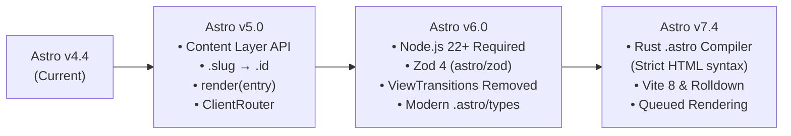

# Astro v4.4 $\rightarrow$ Astro v7.4 Migration Scenario & Playbook

> **Target Audience**: Junior Software Engineers & AI Coding Models  
> **Current State**: Astro `^4.4.13` (Legacy Content Collections, Vite 5, Go `.astro` compiler, Node 18/20)  
> **Target State**: Astro `^7.4.0` (Content Layer API, Zod 4, Vite 8 / Rolldown, Rust `.astro` compiler, Node 22+)

---

## 1. Executive Summary: What Changed Between Astro v4 and v7.4?

Upgrading this project from **Astro v4.4** to **Astro v7.4** crosses three major releases (v5, v6, and v7). Because this project is a static site with zero SSR adapters, the migration is straightforward but requires **exact updates to 14 files** across 5 breaking areas:



| Breaking Change Category | Introduced In | Impact on This Repository |
| :--- | :---: | :--- |
| **1. Runtime Environment** | Astro v6 | Requires **Node.js $\ge$ 22.12.0** (Node 18 and 20 are unsupported). |
| **2. Content Layer API & Zod 4** | Astro v5 & v6 | `src/content/config.ts` moves to `src/content.config.ts`, uses `glob()` loaders, imports `z` from `astro/zod`, replaces `entry.slug` with `entry.id`, and replaces `entry.render()` with `render(entry)`. |
| **3. Removed `ViewTransitions` Import** | Astro v5 & v6 | `src/components/BaseHead.astro` imports `{ ViewTransitions } from "astro:transitions"`, which was removed in favor of `{ ClientRouter }`. |
| **4. Rust Compiler Strict HTML** | Astro v7 | The new Rust `.astro` compiler rejects unclosed tags, duplicate attributes, and self-closing `<div />` tags found in `index.astro`, `TwinklingStars.astro`, and `MeteorShower.astro`. |
| **5. TypeScript Config Modernization** | Astro v6 & v7 | `tsconfig.json` must include `.astro/types.d.ts` directly. |

---

## 2. Complete Impact Matrix (All Files to Modify)

Before writing code, review this checklist of every file in the repository affected by the migration:

| # | File Path | Action | Reason |
| :- | :--- | :--- | :--- |
| 1 | `package.json` | **Edit** | Upgrade `astro` to `^7.4.0` and update `@astrojs/*` integrations. |
| 2 | `tsconfig.json` | **Edit** | Add `".astro/types.d.ts"` to `"include"` array. |
| 3 | `src/content/config.ts` $\rightarrow$ `src/content.config.ts` | **Move & Edit** | Migrate to Content Layer `glob()` loader and `astro/zod`. |
| 4 | `src/components/BaseHead.astro` | **Edit** | Replace removed `ViewTransitions` import with `ClientRouter`. |
| 5 | `src/layouts/ArticleTopLayout.astro` | **Edit** | Handle optional `entry.body` (`readingTime(body ?? "")`). |
| 6 | `src/layouts/ArticleBottomLayout.astro` | **Edit** | Replace `entry.render()` with `render(entry)` and `.slug` with `.id`. |
| 7 | `src/pages/blog/[...slug].astro` | **Edit** | Replace `post.slug` with `post.id` in `getStaticPaths()`. |
| 8 | `src/pages/projects/[...slug].astro` | **Edit** | Replace `project.slug` with `project.id` in `getStaticPaths()`. |
| 9 | `src/pages/legal/[...slug].astro` | **Edit** | Replace `doc.slug` with `doc.id` and `doc.render()` with `render(doc)`. |
| 10 | `src/pages/work/index.astro` | **Edit** | Replace `item.render()` with `render(item)`. |
| 11 | `src/pages/rss.xml.ts` | **Edit** | Replace `item.slug` with `item.id` and use `item.collection === "blog"`. |
| 12 | `src/components/ArrowCard.tsx` | **Edit** | Replace `entry.slug` with `entry.id` in card `href`. |
| 13 | `src/components/Search.tsx` & `SearchCollection.tsx` | **Edit** | Update Fuse.js search keys from `"slug"` to `"id"`. |
| 14 | `src/pages/index.astro`, `TwinklingStars.astro`, `MeteorShower.astro` | **Edit** | Fix malformed HTML for Astro v7's strict Rust compiler. |

---

## 3. Step-by-Step Migration Execution Plan

Follow these phases in order. Do not skip steps.

---

### Phase 1: Upgrade Node.js & Dependencies

#### Step 1.1: Verify Node.js Version
Astro v6+ and v7.4 strictly require **Node.js 22 or newer**.
```bash
node -v
# Must output v22.12.0 or higher (e.g. v22.x or v24.x)
```

#### Step 1.2: Upgrade Astro and Official Integrations
Run the official upgrade CLI or update `package.json`:
```bash
npx @astrojs/upgrade
```

If updating `package.json` manually, update the dependencies block as follows (keeping Tailwind v3 for zero CSS regressions, or see Phase 6 for optional Tailwind v4 migration):

```json
{
  "dependencies": {
    "@astrojs/check": "^0.9.6",
    "@astrojs/mdx": "^5.0.0",
    "@astrojs/rss": "^4.0.15",
    "@astrojs/sitemap": "^3.7.0",
    "@astrojs/solid-js": "^5.0.0",
    "@astrojs/tailwind": "^6.0.2",
    "@tailwindcss/typography": "^0.5.16",
    "astro": "^7.4.0",
    "clsx": "^2.1.1",
    "fuse.js": "^7.1.0",
    "sharp": "^0.34.0",
    "solid-js": "^1.9.5",
    "tailwind-merge": "^2.6.0",
    "tailwindcss": "^3.4.17",
    "typescript": "^5.8.2"
  }
}
```
Then install dependencies:
```bash
npm install
```

#### Step 1.3: Update `tsconfig.json`
In Astro v6 and v7, `.astro/types.d.ts` should be included directly in `tsconfig.json`:

**File**: `tsconfig.json`
```diff
   "include": [
+    ".astro/types.d.ts",
     "src/**/*.ts",
     "src/**/*.tsx",
     "src/**/*.astro"
   ],
```

---

### Phase 2: Migrate Content Collections to Content Layer API (Astro v5 & v6)

In Astro v4, content collections lived in `src/content/config.ts` and used `type: "content"`.  
In Astro v5–v7:
1. The config file **must** be moved to `src/content.config.ts` (at the root of `src/`).
2. Each collection uses the `glob()` loader from `"astro/loaders"`.
3. `z` is imported from `"astro/zod"` (updated for Zod 4 in Astro v6+).

#### Step 2.1: Move `src/content/config.ts` $\rightarrow$ `src/content.config.ts`
Delete `src/content/config.ts` and create `src/content.config.ts` with the following exact contents:

**File**: `src/content.config.ts`
```ts
import { defineCollection } from "astro:content"
import { glob } from "astro/loaders"
import { z } from "astro/zod"

const work = defineCollection({
  loader: glob({ pattern: "**/*.{md,mdx}", base: "./src/content/work" }),
  schema: z.object({
    company: z.string(),
    role: z.string(),
    dateStart: z.coerce.date(),
    dateEnd: z.union([z.coerce.date(), z.string()]),
  }),
})

const blog = defineCollection({
  loader: glob({ pattern: "**/*.{md,mdx}", base: "./src/content/blog" }),
  schema: z.object({
    title: z.string(),
    summary: z.string(),
    date: z.coerce.date(),
    tags: z.array(z.string()),
    draft: z.boolean().optional(),
  }),
})

const projects = defineCollection({
  loader: glob({ pattern: "**/*.{md,mdx}", base: "./src/content/projects" }),
  schema: z.object({
    title: z.string(),
    summary: z.string(),
    date: z.coerce.date(),
    tags: z.array(z.string()),
    draft: z.boolean().optional(),
    demoUrl: z.string().optional(),
    repoUrl: z.string().optional(),
  }),
})

const legal = defineCollection({
  loader: glob({ pattern: "**/*.{md,mdx}", base: "./src/content/legal" }),
  schema: z.object({
    title: z.string(),
    date: z.coerce.date(),
  }),
})

export const collections = { work, blog, projects, legal }
```

> [!NOTE]
> **How `glob()` generates `entry.id`**: When a blog post is at `src/content/blog/01-astro-sphere-file-structure/index.md`, `glob()` automatically strips `/index.md` and sets `entry.id = "01-astro-sphere-file-structure"`. This matches the old `entry.slug` value 1-for-1, preserving all existing URLs!

---

### Phase 3: Update `.slug` $\rightarrow$ `.id` and `entry.render()` $\rightarrow$ `render(entry)`

In the Content Layer API:
- `entry.slug` no longer exists $\rightarrow$ use **`entry.id`**.
- `await entry.render()` no longer exists $\rightarrow$ use **`await render(entry)`** imported from `"astro:content"`.
- `entry.body` is now optional (`string | undefined`) $\rightarrow$ use **`entry.body ?? ""`**.

Apply the following exact diffs:

#### Step 3.1: `src/layouts/ArticleTopLayout.astro`
```diff
-      {readingTime(body)}
+      {readingTime(body ?? "")}
```

#### Step 3.2: `src/layouts/ArticleBottomLayout.astro`
```diff
 ---
-import { type CollectionEntry, getCollection } from "astro:content"
+import { type CollectionEntry, getCollection, render } from "astro:content"
 
 type Props = {
   entry: CollectionEntry<"blog"> | CollectionEntry<"projects">
 }
 
 // Get the requested entry
 const { entry } = Astro.props
 const { collection } = entry
-const { Content } = await entry.render()
+const { Content } = await render(entry)
 
 // Get the next and prev entries (modulo to wrap index)
 const items = (await getCollection(collection))
   .filter(post => !post.data.draft)
   .sort((a, b) => b.data.date.getTime() - a.data.date.getTime())
-const index = items.findIndex(x => x.slug === entry.slug)
+const index = items.findIndex(x => x.id === entry.id)
 const prev = items[(index - 1 + items.length) % items.length]
 const next = items[(index + 1) % items.length]
 ---
 
 <div>
   <article>
     <Content/>
   </article>
   <div class="grid grid-cols-1 sm:grid-cols-2 gap-4">
-    <a href={`/${prev.collection}/${prev.slug}`} class="group p-4 gap-3 flex items-center border rounded-lg hover:bg-black/5 hover:dark:bg-white/10 border-black/15 dark:border-white/20 blend">
+    <a href={`/${prev.collection}/${prev.id}`} class="group p-4 gap-3 flex items-center border rounded-lg hover:bg-black/5 hover:dark:bg-white/10 border-black/15 dark:border-white/20 blend">
...
-    <a href={`/${next.collection}/${next.slug}`} class="group p-4 gap-3 flex items-center border rounded-lg hover:bg-black/5 hover:dark:bg-white/10 border-black/15 dark:border-white/20 transition-colors duration-300 ease-in-out">
+    <a href={`/${next.collection}/${next.id}`} class="group p-4 gap-3 flex items-center border rounded-lg hover:bg-black/5 hover:dark:bg-white/10 border-black/15 dark:border-white/20 transition-colors duration-300 ease-in-out">
```

#### Step 3.3: `src/pages/blog/[...slug].astro`
```diff
 export async function getStaticPaths() {
 	const posts = await getCollection("blog")
 	return posts.map((post) => ({
-		params: { slug: post.slug },
+		params: { slug: post.id },
 		props: post,
 	}))
 }
```

#### Step 3.4: `src/pages/projects/[...slug].astro`
```diff
 export async function getStaticPaths() {
 	const projects = await getCollection("projects")
 	return projects.map((project) => ({
-		params: { slug: project.slug },
+		params: { slug: project.id },
 		props: project,
 	}))
 }
```

#### Step 3.5: `src/pages/legal/[...slug].astro`
```diff
 ---
-import { type CollectionEntry, getCollection } from "astro:content"
+import { type CollectionEntry, getCollection, render } from "astro:content"
 import PageLayout from "@layouts/PageLayout.astro"
...
 export async function getStaticPaths() {
 	const docs = await getCollection("legal")
 	return docs.map((doc) => ({
-		params: { slug: doc.slug },
+		params: { slug: doc.id },
 		props: doc,
 	}))
 }
 
 // Get the requested legal doc
 type Props = CollectionEntry<"legal">;
 const doc = Astro.props
 const { title, date } = doc.data
-const { Content } = await doc.render();
+const { Content } = await render(doc);
 ---
```

#### Step 3.6: `src/pages/work/index.astro`
```diff
 ---
-import { getCollection } from "astro:content"
+import { getCollection, render } from "astro:content"
 import PageLayout from "@layouts/PageLayout.astro"
...
 const work = await Promise.all(
   collection.map(async (item) => {
-    const { Content } = await item.render()
+    const { Content } = await render(item)
     return { ...item, Content }
   })
 )
```

#### Step 3.7: `src/pages/rss.xml.ts`
```diff
     items: items.map((item) => ({
       title: item.data.title,
       description: item.data.summary,
       pubDate: item.data.date,
-      link: item.slug.startsWith("blog")
-        ? `/blog/${item.slug}/`
-        : `/projects/${item.slug}/`,
+      link: item.collection === "blog"
+        ? `/blog/${item.id}/`
+        : `/projects/${item.id}/`,
     })),
```

#### Step 3.8: `src/components/ArrowCard.tsx`
```diff
 export default function ArrowCard({ entry, pill }: Props) {
   return (
-    <a href={`/${entry.collection}/${entry.slug}`} class="group p-4 gap-3 flex items-center border rounded-lg hover:bg-black/5 hover:dark:bg-white/10 border-black/15 dark:border-white/20 transition-colors duration-300 ease-in-out">
+    <a href={`/${entry.collection}/${entry.id}`} class="group p-4 gap-3 flex items-center border rounded-lg hover:bg-black/5 hover:dark:bg-white/10 border-black/15 dark:border-white/20 transition-colors duration-300 ease-in-out">
```

#### Step 3.9: `src/components/Search.tsx` & `src/components/SearchCollection.tsx`
In both `src/components/Search.tsx` (line 16) and `src/components/SearchCollection.tsx` (line 23), update Fuse.js `keys`:
```diff
   const fuse = new Fuse(data, {
-    keys: ["slug", "data.title", "data.summary", "data.tags"],
+    keys: ["id", "data.title", "data.summary", "data.tags"],
     includeMatches: true,
     minMatchCharLength: 2,
     threshold: 0.4,
   })
```

---

### Phase 4: Replace Removed `ViewTransitions` Import (Astro v6)

In `src/components/BaseHead.astro`, `ViewTransitions` was deprecated in Astro v5 and removed in Astro v6 in favor of `ClientRouter`.

**File**: `src/components/BaseHead.astro`
```diff
 ---
-import { ViewTransitions } from "astro:transitions"
+import { ClientRouter } from "astro:transitions"
 
 interface Props {
```
And on line 58 (if you ever uncomment it):
```diff
-<!-- <ViewTransitions  /> -->
+<!-- <ClientRouter /> -->
```

---

### Phase 5: Fix Malformed HTML for the Astro v7 Rust Compiler

> [!WARNING]
> **Critical for Astro v7.4**: Astro v7 uses a new **Rust-based `.astro` compiler** by default. Unlike the old Go compiler in v4–v6, the Rust compiler strictly enforces valid HTML structure and throws build errors on unclosed tags, duplicate attributes, or self-closing non-void HTML tags (`<div />`).

Fix these 3 files in the repository:

#### Step 5.1: `src/pages/index.astro` (Self-closing `<div />` & Unclosed `<div>`)
1. On **line 75**, change the self-closing `<div id="blur" ... />` to have an explicit closing `</div>`:
   ```diff
   -          <div id="blur" class='w-full h-20 rounded-full bg-neutral-900/25 dark:bg-white/25 blur-3xl'/>
   +          <div id="blur" class="w-full h-20 rounded-full bg-neutral-900/25 dark:bg-white/25 blur-3xl"></div>
   ```
2. On **lines 193–216** (inside `<!-- Contact Section -->`), `<div>` on line 193 is missing its closing `</div>` tag before `</section>`:
   ```diff
               ))}
             </div>
   +        </div>
         </section>
   ```

#### Step 5.2: `src/components/TwinklingStars.astro` (Duplicate `class` attribute)
On **lines 10–19**, `<svg id="twinkle-star">` defines `class="template"` on line 12 and a second `class="absolute left-full animate-twinkle"` on line 18. Merge them into a single `class` attribute:
```diff
 <svg 
   id="twinkle-star" 
-  class="template" 
+  class="template absolute left-full animate-twinkle" 
   width="149" 
   height="149" 
   viewBox="0 0 149 149" 
   fill="none" 
   xmlns="http://www.w3.org/2000/svg"
-  class="absolute left-full animate-twinkle"
 >
```

#### Step 5.3: `src/components/MeteorShower.astro` (Self-closing `<div />` tags)
On **lines 12–15**, replace the four self-closing `<div class="shower ..." />` tags with standard closing tags:
```diff
 <div id="meteors">
   <!-- rotations defined in base.css & tailwind.config.mjs -->
-  <div class="shower ur" />
-  <div class="shower dr" /> 
-  <div class="shower dl" />
-  <div class="shower ul" />
+  <div class="shower ur"></div>
+  <div class="shower dr"></div>
+  <div class="shower dl"></div>
+  <div class="shower ul"></div>
 </div>
```

---

### Phase 6 (Optional Enhancement): Migrate Tailwind v3 (`@astrojs/tailwind`) $\rightarrow$ Tailwind v4 (`@tailwindcss/vite`)

In Astro v6 and v7.4, `@astrojs/tailwind` is considered legacy in favor of Tailwind v4's official Vite plugin (`@tailwindcss/vite`), which runs natively on Astro v7's Vite 8 bundler.

If you want to modernize Tailwind at the same time:
1. **Replace packages**:
   ```bash
   npm uninstall @astrojs/tailwind
   npm install tailwindcss@^4.0.0 @tailwindcss/vite@^4.0.0 @tailwindcss/typography@^0.5.16
   ```
2. **Update `astro.config.mjs`**:
   ```js
   import { defineConfig } from "astro/config"
   import mdx from "@astrojs/mdx"
   import sitemap from "@astrojs/sitemap"
   import solidJs from "@astrojs/solid-js"
   import tailwindcss from "@tailwindcss/vite"

   export default defineConfig({
     site: "https://astro-sphere-demo.vercel.app",
     integrations: [mdx(), sitemap(), solidJs()],
     vite: {
       plugins: [tailwindcss()],
     },
   })
   ```
3. **Update top of `src/styles/global.css`**:
   ```diff
   -@tailwind base;
   -@tailwind components;
   -@tailwind utilities;
   +@import "tailwindcss";
   +@config "../../tailwind.config.mjs";
   ```
   *(Using `@config "../../tailwind.config.mjs";` preserves all custom animations, `darkMode: ["class"]`, and typography settings in `tailwind.config.mjs` without rewriting them!)*

---

## 4. Verification & Testing Scenario

After completing Phases 1–5, execute this exact verification sequence:

### Step 1: Regenerate Astro Content Layer Types
```bash
npx astro sync
```
- **Expected Result**: Creates `.astro/types.d.ts` and `.astro/data-store.json` for the 4 collections (`work`, `blog`, `projects`, `legal`) with zero schema errors.

### Step 2: Run TypeScript & Rust Compiler Check + Production Build
```bash
npm run build
```
*(This runs `astro check && astro build`)*
- **Expected Result**:
  - `astro check` reports `0 errors`, `0 warnings`.
  - `astro build` compiles all static routes (`/`, `/work`, `/blog`, `/blog/*`, `/projects`, `/projects/*`, `/search`, `/legal/*`, `/rss.xml`, `/robots.txt`, `/sitemap-index.xml`) into `./dist/`.

### Step 3: Manual Smoke Test Checklist (`npm run preview`)
Start the preview server (`npm run preview`) and verify:
- [ ] **Home Page (`/`)**: Hero animations (particles in light mode, twinkling stars & meteors in dark mode) render and "Let's Connect" section layout is intact.
- [ ] **Theme Toggle**: Clicking the sun/moon button in the header switches between Light and Dark mode.
- [ ] **Blog & Projects Index (`/blog`, `/projects`)**: SolidJS `<SearchCollection client:load />` filters items by tag, searches by keyword, and toggles ascending/descending sort.
- [ ] **Article Detail Pages (`/blog/01-astro-sphere-file-structure`, `/projects/project-1`)**: Clicking an `ArrowCard` navigates to the right URL, renders Markdown/MDX content (including `<Counter client:load />` on `/blog/05-astro-sphere-writing-mdx`), shows reading time, and "Prev / Next" buttons work.
- [ ] **Global Search (`/search`)**: Typing a query returns matching blog posts and projects.
- [ ] **RSS Feed (`/rss.xml`)**: Returns valid XML with `/blog/<id>/` and `/projects/<id>/` links.
