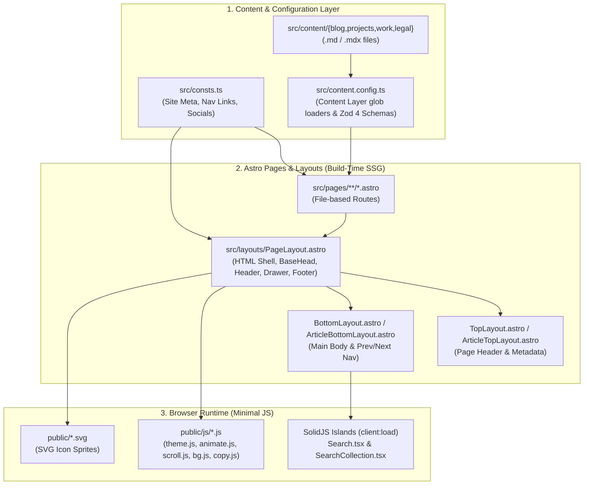

# Personal Profile (Astro Sphere) — High-Level Design & Developer Guide

> **Purpose of this Document**: This guide is designed for **Junior Software Engineers** and **AI Coding Assistants (including lightweight/fast models)**. It explains how the codebase works at a high level and provides exact, step-by-step recipes for adding features, pages, and content without breaking existing conventions.

---

## 1. Executive Summary & Tech Stack

This project is a static, ultra-fast personal portfolio and blog built on the **Astro Sphere** template. It compiles Markdown/MDX files and Astro components into static HTML/CSS at build time, shipping **zero JavaScript by default** except for small interactive "islands" (like search and tag filtering) powered by **SolidJS**.

| Layer | Technology | Role in Project |
| :--- | :--- | :--- |
| **Framework** | [Astro v7.4](https://astro.build/) (Static Site Generation) | File-based routing, layouts, build-time content rendering, RSS & Sitemap generation. |
| **Interactive UI** | [SolidJS](https://www.solidjs.com/) (`@astrojs/solid-js`) | Client-side interactive islands (`Search.tsx`, `SearchCollection.tsx`, `Counter.tsx`). |
| **Styling** | [Tailwind CSS v4](https://tailwindcss.com/) + `@tailwindcss/typography` | Utility-first styling via `@tailwindcss/vite`, dark/light mode (`class` strategy), and Markdown prose styling. |
| **Content Engine** | Astro Content Layer API + [Zod 4](https://zod.dev/) | Type-safe Markdown (`.md`) and MDX (`.mdx`) content loaded via `glob()` loaders in `src/content.config.ts`. |
| **Client Search** | [Fuse.js v7](https://www.fusejs.io/) | Fuzzy client-side search across blog posts and projects. |
| **Language** | TypeScript (Strict mode) | Type checking across `.ts`, `.tsx`, and `.astro` files (`astro check`). |

---

## 2. High-Level System Architecture

### 2.1 Build & Request Data Flow



### 2.2 Layout Hierarchy

Every user-facing page (except the Home page hero) follows a strict **3-tier layout wrapper pattern**:

```text
<PageLayout title="..." description="...">       <!-- Renders <html>, <BaseHead>, <Header>, <Drawer>, <main>, <Footer> -->
  <TopLayout>                                    <!-- Adds top padding (pt-36 pb-5) and medium <Container> -->
    <!-- Page Title / Header Content (or <ArticleTopLayout entry={...} />) -->
  </TopLayout>
  <BottomLayout>                                 <!-- Adds flex-1 py-5 and medium <Container> -->
    <!-- Main Page Content (or <ArticleBottomLayout entry={...} />) -->
  </BottomLayout>
</PageLayout>
```

---

## 3. Complete Directory & File Map

### Path Aliases (`tsconfig.json`)
Always use `@` path aliases instead of relative `../../` paths when importing from `src/`:
- `@components/*` $\rightarrow$ `src/components/*`
- `@layouts/*` $\rightarrow$ `src/layouts/*`
- `@lib/*` $\rightarrow$ `src/lib/*`
- `@styles/*` $\rightarrow$ `src/styles/*`
- `@consts` $\rightarrow$ `src/consts.ts`
- `@types` $\rightarrow$ `src/types.ts`

### Repository Structure
```text
/
├── astro.config.mjs               # Astro config: site URL, MDX, Sitemap, SolidJS, @tailwindcss/vite
├── tailwind.config.mjs            # Tailwind config: dark mode ('class'), Atkinson font, star/meteor keyframes
├── tsconfig.json                  # TypeScript config: SolidJS JSX settings, .astro/types.d.ts & @* path alias
├── package.json                   # Scripts and dependencies
├── public/                        # Static assets served directly at root URL '/'
│   ├── fonts/                     # Atkinson Hyperlegible font files (regular & bold .woff)
│   ├── js/                        # Vanilla JS scripts injected globally or per-page
│   │   ├── animate.js             # Adds '.show' class sequentially (150ms stagger) to '.animate' elements
│   │   ├── bg.js                  # Generates CSS box-shadow particles (light mode) & stars (dark mode) on Home
│   │   ├── copy.js                # Attaches "Copy to Clipboard" buttons to all <pre><code> blocks
│   │   ├── scroll.js              # Toggles '.scrolled' class on #header when window.scrollY > 0
│   │   └── theme.js               # Light/Dark mode toggle + localStorage persistence + system preference
│   ├── brand.svg                  # Header/Footer logo sprite (#brand)
│   ├── copy.svg                   # Clipboard icon sprite (#empty, #filled)
│   ├── social.svg                 # Social icon sprite (#email, #github, #linkedin, #twitter-x)
│   ├── stack.svg                  # Tech stack icon sprite (#astro, #javascript, #typescript, #tailwind)
│   └── ui.svg                     # UI icon sprite (#search, #rss, #sun, #moon, #menu, #x, #calendar, etc.)
└── src/
    ├── consts.ts                  # SINGLE SOURCE OF TRUTH for site title, page titles, nav links, socials
    ├── content.config.ts          # Content Layer API: glob loaders & Zod 4 schemas for collections
    ├── types.ts                   # TypeScript interfaces for src/consts.ts (Site, Page, Links, Socials)
    ├── styles/
    │   └── global.css             # Tailwind v4 import, font-face, dark mode base styles, .animate, .blend
    ├── lib/
    │   └── utils.ts               # Helpers: cn() (clsx+twMerge), formatDate(), readingTime(), truncateText()
    ├── content/                   # Content Collections Markdown / MDX data store
    │   ├── blog/                  # Blog posts (each in a subfolder with index.md or index.mdx)
    │   ├── projects/              # Portfolio projects (subfolder with index.md)
    │   ├── work/                  # Work history entries (flat .md files, e.g. google.md)
    │   └── legal/                 # Legal pages (privacy.md, terms.md)
    ├── layouts/                   # Reusable Astro page & article wrappers
    │   ├── PageLayout.astro       # Master HTML shell
    │   ├── TopLayout.astro        # Upper section container
    │   ├── BottomLayout.astro     # Lower section container
    │   ├── ArticleTopLayout.astro # Back button, date, read time, title, demo/repo links for blog/projects
    │   └── ArticleBottomLayout.astro # Renders MDX <Content /> + Prev/Next circular navigation cards
    ├── components/                # UI Building Blocks (.astro = static, .tsx = SolidJS interactive)
    │   ├── BaseHead.astro         # <head> meta tags, OpenGraph, font preloads, global <script> tags
    │   ├── Header.astro           # Fixed top navbar + desktop links + mobile drawer toggle button
    │   ├── Drawer.astro           # Mobile full-screen navigation overlay
    │   ├── Footer.astro           # Back-to-top button, "All systems normal" badge, legal links, social icons
    │   ├── Container.astro        # Responsive max-width wrapper (size: "sm" | "md" | "lg" | "xl" | "2xl")
    │   ├── StackCard.astro        # Tech stack badge with icon from /stack.svg
    │   ├── TwinklingStars.astro   # Dark-mode animated SVG star generator (Home page)
    │   ├── MeteorShower.astro     # Dark-mode animated CSS meteor shower (Home page)
    │   ├── ArrowCard.tsx          # [SolidJS] Clickable card for a blog post or project with tags & hover arrow
    │   ├── SearchBar.tsx          # [SolidJS] Text input with search icon and clear ('x') button
    │   ├── Search.tsx             # [SolidJS] Global fuzzy search bar + results list (used on /search)
    │   ├── SearchCollection.tsx   # [SolidJS] Sidebar tag filter + search bar + sort toggle (used on /blog & /projects)
    │   └── Counter.tsx            # [SolidJS] Example stateful button used inside MDX blog post
    └── pages/                     # File-based routing (each file becomes an endpoint/page)
        ├── index.astro            # '/' — Home page (Hero, About, Recent Posts, Tech Stack, Recent Projects, Connect)
        ├── work/index.astro       # '/work' — Chronological work experience timeline
        ├── blog/index.astro       # '/blog' — Filterable & searchable list of blog posts
        ├── blog/[...slug].astro   # '/blog/:slug' — Individual blog post page
        ├── projects/index.astro   # '/projects' — Filterable & searchable list of projects
        ├── projects/[...slug].astro # '/projects/:slug' — Individual project page
        ├── search/index.astro     # '/search' — Global search across all blog posts & projects
        ├── legal/[...slug].astro  # '/legal/:slug' — Terms and Privacy pages
        ├── rss.xml.ts             # '/rss.xml' — Auto-generated RSS feed for blog & projects
        └── robots.txt.ts          # '/robots.txt' — Auto-generated robots.txt pointing to sitemap
```

---

## 4. Core Design Rules & Conventions (Read Before Coding!)

> [!IMPORTANT]
> **Rule #1: `.tsx` files use SolidJS, NOT React!**
> If you create or edit a `.tsx` file, remember that `tsconfig.json` sets `"jsxImportSource": "solid-js"`.
> - **DO NOT** use React hooks (`useState`, `useEffect`, `useMemo`, `useRef`).
> - **DO** use SolidJS primitives (`createSignal`, `createEffect`, `onMount`, `<For each={...}>`).
> - **DO** call signals as functions to read their value: `count()` instead of `count`.
> - **DO** use standard HTML attributes `class="..."` and `onInput={...}` instead of React's `className` or `onChange`.

> [!IMPORTANT]
> **Rule #2: Always support both Light and Dark mode in Tailwind classes.**
> The site uses `darkMode: ["class"]` toggled on `<html>`. Follow these exact color pairings so new UI matches the existing design:
> - **Backgrounds**: `bg-white dark:bg-black` (surfaces/cards: `bg-black/5 dark:bg-white/10`)
> - **Primary Text (Headings)**: `text-black dark:text-white`
> - **Body/Muted Text**: `text-black/75 dark:text-white/75` (default on `<body>`)
> - **Borders**: `border-black/15 dark:border-white/20` (or `border-black/10 dark:border-white/25`)
> - **Interactive Hover**: `hover:bg-black/5 hover:dark:bg-white/10` and `hover:text-black hover:dark:text-white`
> - **Smooth Transitions**: Add the custom class `blend` (defined in `global.css` as `transition-all duration-300 ease-in-out`).

> [!IMPORTANT]
> **Rule #3: Entrance Animations use the `.animate` class.**
> Any major section block given `class="animate"` starts invisible (`opacity: 0; transform: translateY(50px)`) and is revealed sequentially by `public/js/animate.js` on page load (150ms delay per element).
> - Put `class="animate"` on top-level page sections (typically 2 to 6 per page).
> - Do **not** put `class="animate"` on 50 individual small items, or item #50 will take 7.5 seconds to appear!

> [!IMPORTANT]
> **Rule #4: Icons use SVG Sprites in `public/*.svg`.**
> Instead of installing icon libraries, icons are stored as `<symbol id="icon-name">` inside `public/ui.svg`, `public/social.svg`, `public/stack.svg`, and `public/brand.svg`, and rendered like this:
> ```html
> <svg class="size-5 stroke-current">
>   <use href="/ui.svg#icon-name"></use>
> </svg>
> ```

---

## 5. Step-by-Step Playbooks for Common Tasks

### Playbook A: Update Personal Info, Bio, Navigation, or Social Links
1. **Site Title, Author, Navigation Links, and Social Links**:
   - Edit `src/consts.ts`.
   - Modify `SITE` (`TITLE`, `DESCRIPTION`, `AUTHOR`), `LINKS`, or `SOCIALS`.
2. **Production Domain URL**:
   - Edit `astro.config.mjs` and update the `site: "https://..."` field (used for Sitemap, RSS, and Canonical URLs).
3. **Home Page Hero & "About Me" Text**:
   - Edit `src/pages/index.astro`:
     - Lines 82–90: Hero greeting (`Hello, I am ...`, name, tagline).
     - Lines 20–41: `const stack = [...]` array for the "Website build with" tech stack cards.
     - Lines 108–117: About section paragraphs (`<article>...</article>`).

---

### Playbook B: Add Content (Blog Post, Project, Work Experience, Legal Doc)

All content lives in `src/content/` and is validated against `src/content/config.ts` at build time.

#### 1. Add a Blog Post
- Create a new folder and file: `src/content/blog/<your-post-slug>/index.md` (or `index.mdx` if embedding components).
- Include required frontmatter:
  ```markdown
  ---
  title: "My New Blog Post"
  summary: "A short 1-2 sentence summary shown on cards and SEO meta tags."
  date: "Nov 02 2026"
  draft: false
  tags:
    - TypeScript
    - Architecture
  ---

  Write your markdown content here...
  ```

#### 2. Add a Portfolio Project
- Create `src/content/projects/<your-project-slug>/index.md`.
- Include required frontmatter (`demoUrl` and `repoUrl` are optional):
  ```markdown
  ---
  title: "My Awesome Project"
  summary: "Brief summary of what this project does."
  date: "Nov 02 2026"
  draft: false
  tags:
    - Astro
    - Tailwind
  demoUrl: "https://example.com"
  repoUrl: "https://github.com/username/repo"
  ---

  Project details and screenshots here...
  ```

#### 3. Add a Work Experience Entry
- Create `src/content/work/<company-slug>.md`.
- Include required frontmatter (`dateEnd` can be a date string or `"Now"`):
  ```markdown
  ---
  company: "Acme Corp"
  role: "Senior Software Engineer"
  dateStart: "01/15/2024"
  dateEnd: "Now"
  ---

  Brief paragraph or bullet points describing accomplishments:
  - Built X using Y, improving Z by 40%.
  ```

---

### Playbook C: Add a New Top-Level Page (e.g., `/uses` or `/contact`)

Follow these exact 3 steps to add a new page and include it in the navigation bar:

1. **Add Page Metadata & Nav Link in `src/consts.ts`**:
   ```ts
   export const USES: Page = {
     TITLE: "Uses",
     DESCRIPTION: "Hardware, software, and tools I use daily.",
   }
   ```
   And append `{ TEXT: "Uses", HREF: "/uses" }` to the `LINKS` array in `src/consts.ts`.
   *(Both desktop `Header.astro` and mobile `Drawer.astro` automatically read from `LINKS`!)*

2. **Create the Page File at `src/pages/uses/index.astro`**:
   Use the standard `PageLayout` + `TopLayout` + `BottomLayout` template:
   ```astro
   ---
   import PageLayout from "@layouts/PageLayout.astro"
   import TopLayout from "@layouts/TopLayout.astro"
   import BottomLayout from "@layouts/BottomLayout.astro"
   import { USES } from "@consts"
   ---

   <PageLayout title={USES.TITLE} description={USES.DESCRIPTION}>
     <TopLayout>
       <div class="animate page-heading">
         {USES.TITLE}
       </div>
       <div class="animate mt-1">
         {USES.DESCRIPTION}
       </div>
     </TopLayout>
     <BottomLayout>
       <div class="animate">
         <article class="prose dark:prose-invert">
           <p>Your page content goes here.</p>
         </article>
       </div>
     </BottomLayout>
   </PageLayout>
   ```

3. **Verify**: Run `npm run build` to confirm TypeScript and Astro compile cleanly.

---

### Playbook D: Add a New Content Collection (e.g., `certifications` or `talks`)

If you need a brand-new structured content type:

1. **Define the Schema in `src/content.config.ts`**:
   ```ts
   import { defineCollection } from "astro:content"
   import { glob } from "astro/loaders"
   import { z } from "astro/zod"

   const talks = defineCollection({
     loader: glob({ pattern: "**/*.{md,mdx}", base: "./src/content/talks" }),
     schema: z.object({
       title: z.string(),
       event: z.string(),
       date: z.coerce.date(),
       videoUrl: z.string().optional(),
     }),
   })

   export const collections = { work, blog, projects, legal, talks }
   ```
2. **Add Markdown files** inside `src/content/talks/`.
3. **Sync Astro types**: Run `npx astro sync` (or `npm run build`) so `getCollection("talks")` is recognized by TypeScript.
4. **Query in any `.astro` page**:
   ```ts
   import { getCollection } from "astro:content"
   const talks = (await getCollection("talks")).sort(
     (a, b) => b.data.date.getTime() - a.data.date.getTime()
   )
   ```

---

### Playbook E: Add a New Interactive Component (Astro vs. SolidJS Decision Matrix)

Before creating a component in `src/components/`, choose the right file type:

| Requirement | Use `.astro` Component | Use `.tsx` (SolidJS) Component |
| :--- | :---: | :---: |
| Static UI, layout, cards, or build-time data rendering | ✅ Yes | ❌ No |
| Simple DOM toggle (like opening a modal or scrolling) | ✅ Yes (with `<script>` tag) | ❌ No |
| Complex reactive state (live search, multi-tag filtering, interactive calculators, dynamic forms) | ❌ No | ✅ Yes |

**When using a SolidJS `.tsx` component inside an `.astro` page or `.mdx` file**:
- You **must** pass a client hydration directive such as `client:load` or `client:visible` if it needs interactivity in the browser:
  ```astro
  <MyInteractiveWidget client:load initialItems={items} />
  ```
- Without `client:*`, Astro renders the `.tsx` component to static HTML only (like `ArrowCard.tsx` when used on `index.astro`).

---

### Playbook F: Add a New SVG Icon

1. Open the appropriate sprite file in `public/`:
   - `public/ui.svg` for general UI icons (note: most icons in `ui.svg` use `stroke="currentColor"`).
   - `public/social.svg` for social media icons (uses `fill="currentColor"`).
   - `public/stack.svg` for technology logos.
2. Add a `<symbol id="my-icon" viewBox="0 0 24 24">...</symbol>` inside `<defs>`.
   - Strip hardcoded `fill="#..."` or `stroke="#..."` attributes from paths if you want the icon to adapt to light/dark mode via Tailwind's `fill-current` or `stroke-current`.
3. Reference it anywhere with:
   ```html
   <svg class="size-5 fill-current">
     <use href="/social.svg#my-icon"></use>
   </svg>
   ```

---

## 6. Known Quirks & Technical Debt (Watch Out!)

When debugging or enhancing existing features, keep these codebase-specific details in mind:

1. **RSS Feed Link & Draft Logic (`src/pages/rss.xml.ts`)**:
   - Currently, `rss.xml.ts` fetches `blog` and `projects` without filtering out `draft: true` items.
   - Line 25 checks `item.slug.startsWith("blog")` instead of `item.collection === "blog"`. Because a post's `slug` is just its folder name (e.g., `01-astro-sphere-file-structure`), blog posts in RSS currently get linked to `/projects/<slug>/` unless fixed to check `item.collection === "blog"`.
2. **Draft Posts on Detail Pages (`src/pages/blog/[...slug].astro` & `src/pages/projects/[...slug].astro`)**:
   - Listing pages (`index.astro`, `blog/index.astro`, `projects/index.astro`, `search/index.astro`) filter out drafts via `.filter(post => !post.data.draft)`, and `ArticleBottomLayout.astro` filters out drafts for Prev/Next buttons. However, `getStaticPaths()` in `[...slug].astro` does not filter out drafts yet. If you create a draft post with `draft: true`, also filter it out in `getStaticPaths()` if you don't want its URL generated.
3. **Type Coercion in Search (`src/components/SearchCollection.tsx` & `src/pages/search/index.astro`)**:
   - `SearchCollection.tsx` and `search/index.astro` cast `CollectionEntry<"projects">[]` to `CollectionEntry<"blog">[]` because both collections share the same base fields (`title`, `summary`, `date`, `tags`, `draft`). If you diverge their schemas in `src/content/config.ts`, update the TypeScript union types in `Search.tsx`, `SearchCollection.tsx`, and `ArrowCard.tsx`.
4. **ViewTransitions are Currently Disabled (`src/components/BaseHead.astro`)**:
   - `<ViewTransitions />` is commented out on line 58 of `BaseHead.astro`, even though several scripts listen for `astro:after-swap`. If enabling Astro ViewTransitions in the future, test `public/js/animate.js`, `public/js/copy.js`, and interval timers in `TwinklingStars.astro` / `MeteorShower.astro` to prevent duplicate `setInterval` timers across page navigations.
5. **Copy Code Button Script (`public/js/copy.js`)**:
   - `copy.js` runs once on initial load (`defer`) and attaches a copy button with `.copy-btn { position: fixed; ... }` inside `.copy-cnt { position: absolute; ... }`. If ViewTransitions are enabled later, `copy.js` will need an `astro:after-swap` listener.

---

## 7. Developer Workflow & Verification Checklist

Before completing any task or opening a pull request, always run these commands from the repository root:

```bash
# 1. Install dependencies (if needed)
npm install

# 2. Run TypeScript & Astro diagnostics + production static build
npm run build

# 3. Start local dev server (http://localhost:4321) to visually verify
npm run dev
```

### Pre-Commit Checklist for Engineers & AI Agents
- [ ] Does `npm run build` (`astro check && astro build`) exit with code `0` and zero TypeScript errors?
- [ ] Were all `src/` imports written using `@` aliases (`@components/...`, `@layouts/...`, `@consts`, `@lib/utils`)?
- [ ] Do all new UI elements have both light mode and `dark:` Tailwind classes?
- [ ] If a `.tsx` file was modified, did you use SolidJS syntax (`class`, `createSignal`, `onInput`) instead of React syntax?
- [ ] If a new page or section was added, does it include `class="animate"` on its main container so it fades in smoothly?
